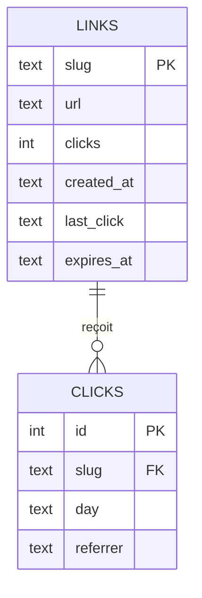

# 🔗 Shortly — Raccourcisseur de liens avec statistiques et QR codes

> Application web complète pour **raccourcir des liens**, choisir un **alias personnalisé**, générer un **QR code** et suivre les **clics jour par jour**.
> Simple à lancer, testée (≈ 95 % de couverture) et conteneurisée.


---

## ✨ Fonctionnalités

- ✂️ **Liens courts** de 7 caractères générés de façon sûre (`crypto`), sans caractères ambigus (`0/O`, `1/l/I`)
- 🏷️ **Alias personnalisé** (`/mon-cv`), avec détection des doublons et des mots réservés
- ⏳ **Date d'expiration** optionnelle (le lien renvoie `410 Gone` une fois expiré)
- 📊 **Statistiques** : nombre total de clics, **graphique des 7 derniers jours**, principales **sources** (LinkedIn, e-mail, accès direct…)
- 📱 **QR code** PNG généré pour chaque lien
- 🗑️ Suppression d'un lien
- 🛡️ **Sécurité** : seules les URL `http`/`https` sont acceptées (pas de `javascript:` ni `file:`), en-têtes HTTP sécurisés avec **Helmet**, requêtes SQL préparées, aucune donnée utilisateur injectée en HTML

## 🖥️ Interface

Une page unique, sans framework : on colle un lien, on récupère le lien court, son QR code, et on suit ses statistiques dans le tableau des derniers liens.

## 🚀 Lancer le projet

```bash
git clone https://github.com/mayssadhahri1/shortly-url-shortener.git
cd shortly-url-shortener
npm install
npm start          # http://localhost:3000
```

Avec Docker :

```bash
docker compose up -d --build
```

| Variable | Défaut | Rôle |
|---|---|---|
| `PORT` | `3000` | Port du serveur |
| `BASE_URL` | `http://localhost:3000` | Domaine utilisé pour construire les liens courts |
| `DB_FILE` | `data/shortly.db` | Fichier de la base SQLite |

## 🔌 API REST

| Méthode | Route | Description |
|---|---|---|
| `POST` | `/api/links` | Créer un lien `{ "url", "alias"?, "expiresInDays"? }` |
| `GET` | `/api/links` | Derniers liens créés |
| `GET` | `/api/links/:slug` | Statistiques détaillées (7 jours, sources) |
| `GET` | `/api/links/:slug/qr` | QR code PNG |
| `DELETE` | `/api/links/:slug` | Supprimer un lien |
| `GET` | `/:slug` | Redirection `302` vers l'URL d'origine (et comptage du clic) |

```bash
curl -X POST localhost:3000/api/links -H "Content-Type: application/json" \
     -d '{"url": "https://github.com/mayssadhahri1", "alias": "github"}'
# {"slug":"github","shortUrl":"http://localhost:3000/github","clicks":0, ...}
```

## 🗃️ Modèle de données



Le compteur de clics et l'historique sont mis à jour **dans une même transaction**.

## 🧪 Tests et qualité

```bash
npm test        # 14 tests Jest + Supertest, base SQLite en mémoire
npm run lint    # ESLint
```

La **CI GitHub Actions** lance le lint et les tests, construit l'image Docker, vérifie qu'une redirection fonctionne dans le conteneur, puis scanne l'image avec **Trivy**.
L'image Docker est construite en **deux étapes** et tourne avec un **utilisateur non root**.

## 📁 Structure

```
src/
├── server.js      # Démarrage et configuration
├── app.js         # Routes Express (API, redirection, erreurs)
├── db.js          # Schéma SQLite et requêtes préparées
└── validation.js  # Validation des URL, des alias, génération des identifiants
public/            # Interface web (HTML, CSS, JavaScript)
tests/             # Tests Jest + Supertest
```

---

👩‍💻 **Mayssa Dhahri** — Élève-ingénieure en Génie Logiciel, École Polytechnique de Sousse
[LinkedIn](https://www.linkedin.com/in/mayssa-dhahri/) · [GitHub](https://github.com/mayssadhahri1)

*Réalisé avec l'aide d'un assistant IA.*
